<p align="center">
  
</p>

<p align="center">
  <b>A cute, pastel, child-friendly bedside alarm clock for the original M5Stack Fire (K007).</b><br>
  12-hour clock with AM/PM &middot; 10 alarms with cartoon melodies &middot; daily routine with reward stars &middot;
  RGB lights &middot; night mode &middot; works with no internet
</p>

<p align="center">
  <a href="https://electroiot.github.io/M5-Fire-Kids-Clock/flasher/"><b>Install in your browser</b></a> &middot;
  <a href="docs/FLASHING.md">Flashing guide</a> &middot;
  <a href="#features">Features</a> &middot;
  <a href="#documentation">Docs</a> &middot;
  <a href="docs/ANDROID_APP_PLAN.md">App plan</a>
</p>

<p align="center">
  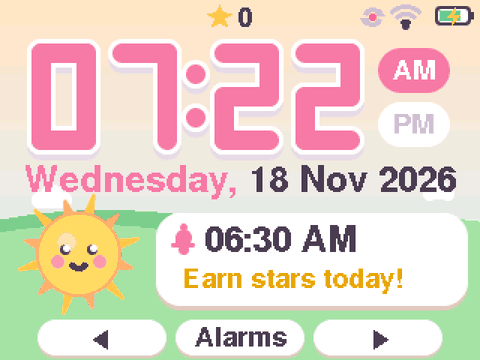
</p>

## Screens

All pictures are real screenshots taken from the device over USB (`tools/kc.py shot`).

| Morning | Afternoon | Evening | Night mode |
|:---:|:---:|:---:|:---:|
|  | 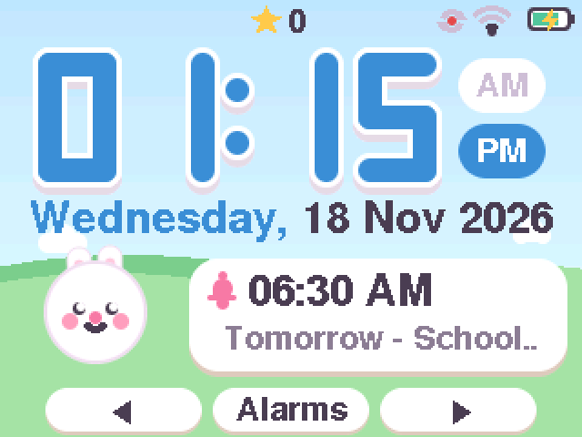 | 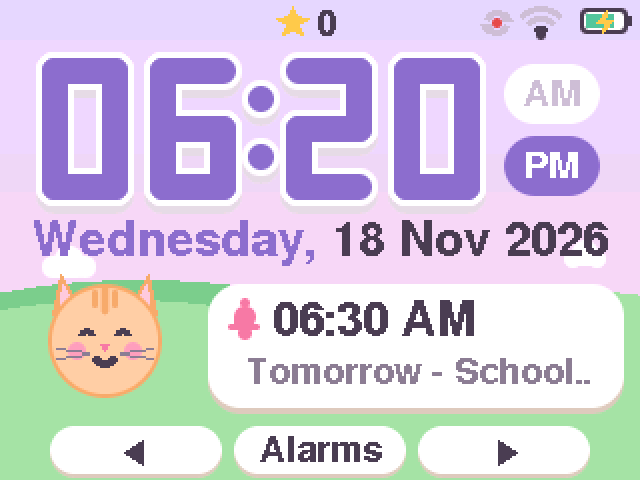 | 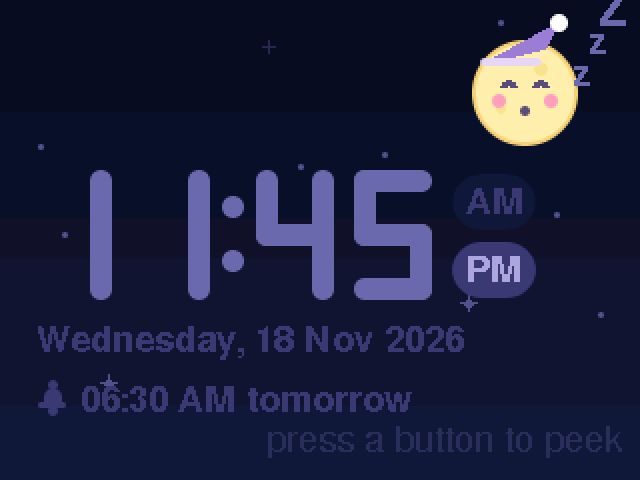 |
| **Alarm ringing** | **Alarms** | **Alarm editor** | **Daily routine** |
| 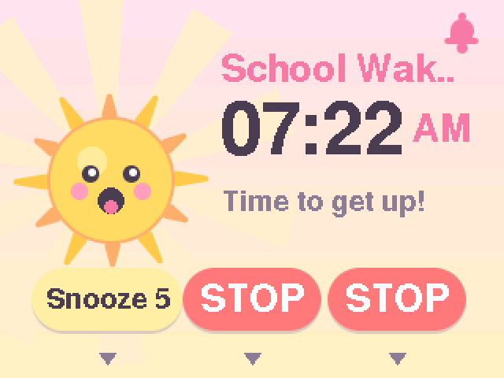 | 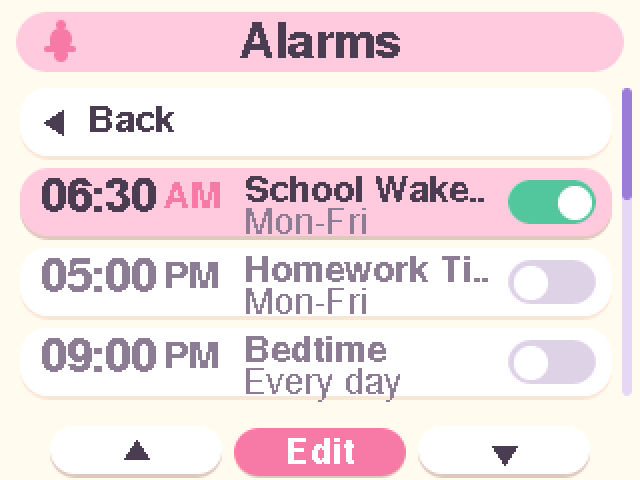 | 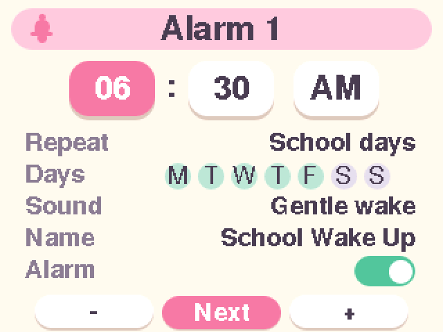 | 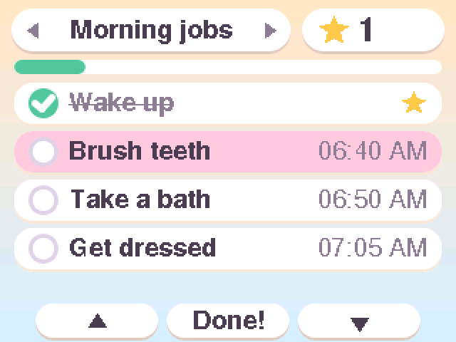 |
| **Stars & badges** | **Reminder** | **Settings** | |
|  | 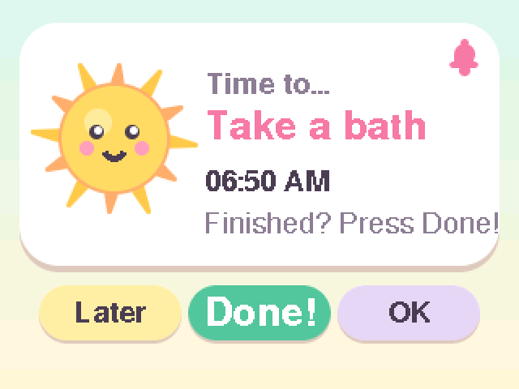 | 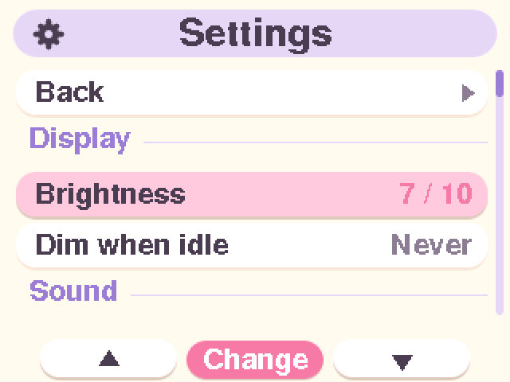 | |

## Features

- **Clock** - big rounded bubble digits, **always 12-hour with AM/PM**, weekday and date
  (`Tuesday, 17 Nov 2026`), India time (Asia/Kolkata, UTC+05:30).
- **Cartoon friends** - Sunny the sun (morning), Bun-Bun the bunny (afternoon), Miko the
  kitty (evening), Luna the sleepy moon (night). They blink, bounce, cheer and snore.
- **10 alarms** - once / every day / school days / weekends / pick days, per-alarm melody and
  name, snooze 5/10/15 min, big STOP buttons, gentle fade-in, auto-snooze, works offline,
  never rings twice in the same minute, survives reboots.
- **Sounds** - 5 alarm tunes (incl. *Frère Jacques* and *Twinkle Twinkle*), click / task /
  reward / notification effects, *Brahms' Lullaby* at bedtime, optional WAV files from microSD.
- **Daily routine** - 15 everyday jobs from "Wake up" to "Sleep", a star for each, bonus
  stars for a full day, badges, pop-up reminders, automatic reset at 3:00 AM.
- **Child's name** - "Good morning, *name*!", "Wake up, *name*!" (stored only on the clock).
- **RGB lights** - sunrise, morning pastels, alarm flash, blue notification, green task done,
  rainbow reward, dim purple night light.
- **Night mode** - very dim minimal clock between your times; press = peek, hold C = skip.
- **Time sync** - NTP on Wi-Fi with protection against bad replies; manual set; optional RTC.
- **Weather** - Open-Meteo, **no API key**, never required.
- **Parent setup from a phone** - scan the QR code on the clock, edit Wi-Fi (plus a backup
  network), alarms, routine, night mode, weather and name in a web page.
- **Battery** - level, charging, low-battery warning.

<p align="center">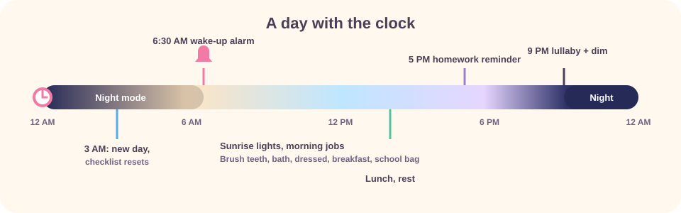</p>

## Install

<p align="center">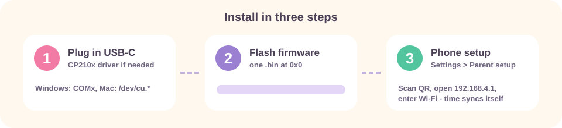</p>

**Easiest:** open the **[web installer](https://electroiot.github.io/M5-Fire-Kids-Clock/flasher/)**
in Chrome or Edge, connect the Fire by USB-C, press *Install*.

**esptool** (firmware from the [Releases](https://github.com/ElectroIoT/M5-Fire-Kids-Clock/releases) page):

```bash
esptool.py --chip esp32 --port COM16 --baud 460800 write_flash 0x0 M5-Fire-Kids-Clock-v1.0.0-full.bin
```

**From source (PlatformIO):**

```bash
pio run -t upload
```

Arduino IDE, updates that keep settings, drivers and troubleshooting: **[docs/FLASHING.md](docs/FLASHING.md)**.

Then on the clock: **Settings > Parent setup (phone)**, scan the QR code, open
`http://192.168.4.1`, enter your Wi-Fi - the time sets itself.

## Controls

<p align="center">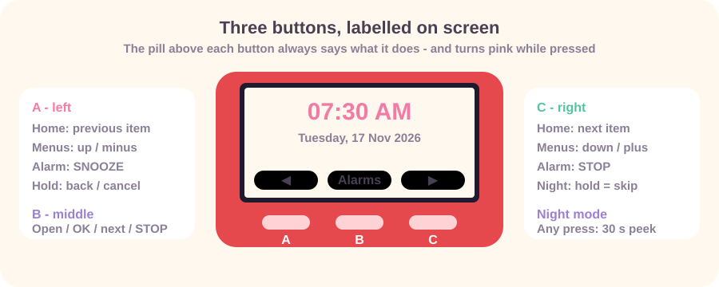</p>

| Screen | A (left) | B (middle) | C (right) |
|---|---|---|---|
| Home | previous menu item | open | next menu item |
| Lists / menus | up | OK / change | down |
| Changing a value | - | confirm | + |
| Alarm ringing | **SNOOZE** | **STOP** | **STOP** |
| Night mode | peek | peek | peek (hold = skip tonight) |
| Anywhere | hold = back / cancel | | |

## Hardware

Original **M5Stack Fire K007**: ESP32-D0WDQ6, 16 MB flash, 8 MB PSRAM, 2" 320x240 IPS
(ILI9342C), 1 W speaker, 10 SK6812 RGB LEDs (M5GO base), 3 buttons, 500 mAh battery.
No extra parts needed. Pin map and notes: [docs/HARDWARE.md](docs/HARDWARE.md).

## How it works

<p align="center">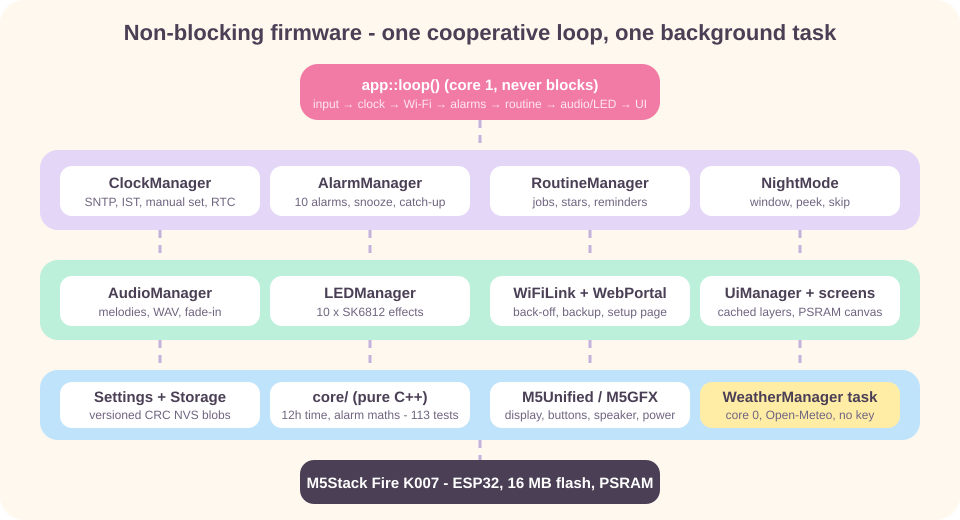</p>

- One cooperative, non-blocking main loop; weather runs in its own FreeRTOS task.
- Every screen draws into a full-screen PSRAM canvas pushed in one go (no flicker); static
  parts are cached so a frame takes about 24 ms to draw.
- Pure time / alarm logic lives in `src/core` and is unit-tested on a PC (113 checks).
- Settings, alarms and routine are versioned, CRC-checked NVS records that survive updates.

| Library | Version |
|---|---|
| Arduino-ESP32 core | 2.0.17 (PlatformIO `espressif32@6.9.0`) |
| M5Unified / M5GFX | 0.3.0 / 0.3.0 |
| Adafruit NeoPixel | 1.15.5 |

```
M5_Fire_Kids_Clock/            Arduino sketch folder (.ino + src/)
  src/app        main loop, night mode, serial console
  src/core       pure logic: 12-hour formatting, calendar, alarm rules (host-tested)
  src/clock      NTP / IST / manual time, optional external RTC
  src/alarm      offline alarm engine        src/routine   jobs, stars, reminders
  src/audio      melodies, microSD WAV       src/led       SK6812 effects
  src/wifi       Wi-Fi + parent web page     src/weather   Open-Meteo task
  src/display    canvas, drawing, characters src/ui        screens
docs/            guides, screenshots, animated SVGs, web installer
test/            host unit tests             tools/        serial console + screenshot tools
```

## Documentation

| Guide | |
|---|---|
| [Flashing & installing](docs/FLASHING.md) | web installer, esptool, PlatformIO, Arduino IDE |
| [Hardware & GPIO](docs/HARDWARE.md) | pin map, Fire-specific notes |
| [Screens](docs/SCREENS.md) | layouts of every screen |
| [Wi-Fi, NTP & weather](docs/WIFI_NTP_WEATHER.md) | setup page, sync rules, Open-Meteo |
| [Alarms](docs/ALARMS.md) | scheduling engine, snooze, edge cases |
| [Offline & RTC](docs/OFFLINE_AND_RTC.md) | what happens without internet or power |
| [Audio & microSD](docs/AUDIO.md) | sounds, WAV format, volume rules |
| [Testing](docs/TESTING.md) | checklist with real results, what is not tested yet |
| [Troubleshooting](docs/TROUBLESHOOTING.md) | common problems |
| [Android app plan](docs/ANDROID_APP_PLAN.md) | companion app design (Wi-Fi + BLE setup) |
| [Roadmap](docs/ROADMAP.md) | ideas |

## Serial console

115200 baud, type `help`. Examples: `status`, `settime 2026-11-17 11:59 PM`, `alarm 1 6:30 AM`,
`ring 1`, `stop`, `routine`, `done 2`, `sound 2`, `led reward`, `key b`, `shot`, `portal`, `flashprep` (before uploads).
`tools/kc.py` talks to it without resetting the board and saves screenshots:

```bash
python tools/kc.py COM16 shot screen.png
```

## Privacy

Wi-Fi passwords and the child's name are stored only in the clock's own flash. Nothing is
sent anywhere except NTP time requests and (if enabled) a weather request with the
latitude/longitude you set.

## License

MIT - see [LICENSE](LICENSE). Melodies used are traditional / public domain.
