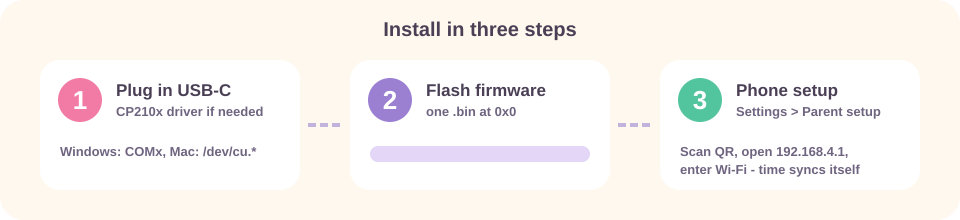

# Flashing & installing



Target: **original M5Stack Fire (K007)**. Do not flash Core2 / CoreS3 / other variants.

| File (Releases page) | Flash at | Use it for |
|---|---|---|
| `M5-Fire-Kids-Clock-v1.0.0-full.bin` | `0x0` | **first install** - bootloader + partitions + app in one file. Erases saved settings. |
| `M5-Fire-Kids-Clock-v1.0.0-app.bin` | `0x10000` | **updates** - app only, **keeps** alarms, routine, stars, Wi-Fi, name |
| `SHA256SUMS.txt` | - | checksums |

The full image was verified on the test unit: flashed at `0x0` with esptool, booted,
connected to Wi-Fi and synced the time.

## Option 1 - in the browser (easiest)

Open the **[web installer](https://electroiot.github.io/M5-Fire-Kids-Clock/flasher/)** in
Chrome or Edge on a computer, connect the Fire, press **Install**, pick the CP210x port.
Uses [ESP Web Tools](https://esphome.github.io/esp-web-tools/); nothing to install.

## Option 2 - esptool (any OS)

```bash
pip install esptool
```

First install (Windows `COM16`, macOS `/dev/cu.usbserial-XXXX`, Linux `/dev/ttyUSB0`):

```bash
esptool.py --chip esp32 --port COM16 --baud 460800 write_flash 0x0 M5-Fire-Kids-Clock-v1.0.0-full.bin
```

Update and keep settings:

```bash
esptool.py --chip esp32 --port COM16 --baud 460800 write_flash 0x10000 M5-Fire-Kids-Clock-v1.0.0-app.bin
```

Uploads at 921600 baud were unreliable on the test unit; 460800 (or 115200) works.

**Important on the Fire:** if the clock is running, send `flashprep` on the serial console
first (PlatformIO does this automatically through `tools/pio_flashprep.py`). It stops the
screen drawing so the reset cannot catch the PSRAM mid-transfer - otherwise the flash
chip can stop answering until the Fire is fully powered off (see Troubleshooting).

## Option 3 - PlatformIO (build from source)

```bash
git clone https://github.com/ElectroIoT/M5-Fire-Kids-Clock.git
```

```bash
cd M5-Fire-Kids-Clock && pio run -t upload
```

`platformio.ini` pins espressif32 6.9.0 (Arduino-ESP32 2.0.17), M5Unified 0.3.0, M5GFX 0.3.0,
Adafruit NeoPixel 1.15.5, 16 MB partitions and PSRAM.

## Option 4 - Arduino IDE

1. Boards Manager: **esp32 by Espressif** - version **2.0.17** is the tested one.
2. Library Manager: **M5Unified** 0.3.0 (installs **M5GFX**), **Adafruit NeoPixel**.
3. Open `M5_Fire_Kids_Clock/M5_Fire_Kids_Clock.ino`.
4. Tools: Board **M5Stack-Fire**, PSRAM **Enabled**, Partition **Default 16MB** (or 16M Flash 6.25MB APP),
   Upload speed **460800**.
5. Upload. Serial Monitor at 115200.

> Arduino-ESP32 **3.x** builds are not verified yet. If 3.x fails, install 2.0.17.

## After flashing

1. The clock shows "What time is it?" - that is normal on a fresh install.
2. **Settings > Parent setup (phone)** - scan the QR code, open `http://192.168.4.1`.
3. Enter Wi-Fi (and optionally a backup network). The time syncs in a few seconds.
4. Optional on the same page: child's name, weather location, alarms, routine jobs.

No Wi-Fi? Use **Settings > Set time & date** - everything else works offline.

## Driver / port problems

- Windows needs the **Silicon Labs CP210x** driver if no COM port appears.
- "Failed to communicate with the flash chip" / "Packet content transfer stopped": unplug,
  double-click the red power button to switch off, plug in again, remove stacked modules,
  try a shorter cable or a lower baud rate.
- "Access is denied" on the COM port: another program (serial monitor, M5Burner) has it open.

## Back up the original firmware first (optional)

```bash
esptool.py --chip esp32 --port COM16 --baud 460800 read_flash 0 0x1000000 fire_backup_16MB.bin
```

Restore later with `write_flash 0 fire_backup_16MB.bin`.
